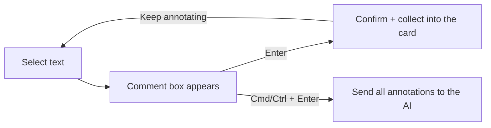

# Annotations — a DSH client plugin

[](https://www.npmjs.com/package/@fanfan4589/dsh-annotation)


Select text in a DeepSeek Harness reply or in a document previewed in the right sidebar; a comment box appears. `Enter` confirms the annotation and collects it into an aggregated "N notes" card above the composer; `Cmd/Ctrl+Enter` sends every pending annotation to the AI in one message.

[中文](README.zh.md)



## Usage

| Action | Result |
| --- | --- |
| Select text | The comment box appears next to the selection and gets focus |
| Type + `Enter` | Confirms the annotation; it is collected into the "N notes" card above the composer |
| `Cmd/Ctrl + Enter` | Confirms and immediately sends **all pending** annotations to the AI (works inside the comment box or while no input is focused) |
| `Shift + Enter` | Newline inside the comment |
| `Cmd/Ctrl + C` with no text selected in the comment box | Copies the passage that opened the box (focusing the box collapses the document selection) |
| `Esc` | Cancels the comment box |
| Click the "N notes" card | Expands the quotes and notes; jump to or delete each one |
| Click a numbered dot / highlighted text | Edit or delete that annotation; the number matches its row in the list |
| Sidebar footer → Annotations | Opens the annotation list as a native **right-sidebar tab** (conversation / documents / other documents), beside the chat instead of over it; jump or delete |

The message the AI receives looks like this:

```text
I annotated 2 specific places below. Please review and act on each one:

1. Quote: "…"
   Location: conversation reply
   Note: …
2. Quote: "…"
   Location: `docs/report.md`
   Note: …
```

The message language follows the current DSH UI language.

## Where it works, and the limits

| Surface | Supported |
| --- | --- |
| Assistant reply body in the conversation | Yes (including expanded reasoning) |
| Markdown / plain text / code previews in the right sidebar | Yes |
| PDF and Word/PowerPoint-to-PDF text layers in the right sidebar | Yes, where text is selectable |
| Excel preview in the right sidebar | No — the grid is not document text |
| HTML / web page previews in the right sidebar | No — the body runs in an opaque-origin iframe, so the parent page cannot read its selection |
| Images, terminal | No |

These limits come from how the host renders those surfaces, not from the plugin.

## Design choices

- **One highlight color.** The comments carry the emphasis, so there is no color picker.
- **Composer stays clean.** Annotations are not pasted into the input as text; they aggregate into one "N notes" card that expands on click.
- **Sidebar list stays.** Open it from the sidebar footer; it docks as a native right-sidebar tab next to documents instead of covering the conversation.
- **No export, copy, or diagnostics extras.** The plugin only annotates and sends.

## Annotation lifecycle

- Annotations live in `localStorage`; the list only shows **chat annotations of the active session plus document annotations**.
- **Deleted session** — its chat annotations are pruned automatically after startup or when the list is opened. The automatic pass only runs once the session index is stable across two counts, so a partially loaded sidebar is never mistaken for deleted sessions.
- **Archived session** — its annotations are kept because the session can be reopened. They do not count toward the active session badge; use "Clean up → Clean other sessions" to remove them.
- **Sent annotations** — highlights and list rows stay until you choose "Clean up → Clean sent annotations".
- **Document annotations** — tied to the file path and never auto-pruned; delete them row by row if needed.

## How it works

- **Client-only bundle.** `index.js` exports an empty `apply()`; all behavior lives in `client.js`.
- **Additive slots only** — no shipped UI is replaced:
  - `shell.overlay` — comment box, highlight dot, edit dialog, annotation list, toasts;
  - `conversation.input.overlay` — the aggregated card above the composer;
  - `sidebar.right.pane.tab` — the annotation list as a right-sidebar tab (registered through `sidebarRightTabs` as the `annotation` kind);
  - `sidebar.footer.action` — the Annotations entry at the sidebar foot, opening or focusing that tab.
- **Highlights use the CSS Custom Highlight API** (`::highlight()` + `CSS.highlights`), so React-owned text is never mutated and streaming/folding cannot conflict.
- **Quote anchoring** — each segment stores `exact/prefix/suffix/start`; re-renders resolve it with context scoring. Chat rows are addressed by `data-chat-anchor-key` inside `[data-conversation-session]`; sidebar documents by `data-textpreview-url` / resource address.
- **Sending** uses `sessions.scope(sessionId).conversation.send(text)` to deliver the batch as one user message.
- **Numbering** — current-session chat annotations plus document annotations are numbered 1..N in creation order; dots, the composer card and the sidebar list share that numbering.
- **Persistence** in `localStorage` under `dsh.annotation.v1` (per browser profile, synced across windows via `storage` events).

## Install

Install from npm:

```bash
dsh plugin --profile <profile> add @fanfan4589/dsh-annotation
```

Or ask the DSH agent to install the checkout with `plugin_manager` `install_bundle`, then refresh the page once.

Uninstall through Plugin Manager; annotations stay in `localStorage`.

## Development

```bash
node build.mjs                 # generate client.js
node --test test/core.test.mjs # 20 pure-logic tests
node test/smoke.mjs            # bundle load + slot registration + component render smoke test
node tools/validate.mjs        # manifest/locale/icon/bundle validation
```

No dependencies beyond Node.js built-ins.

## Known limits

- Annotations live in the current browser profile only.
- PDF support covers selectable text layers; scanned image-only PDFs cannot be annotated.
- Changes to `client.js` need a page refresh.
- If a third-party sidebar renders its own button over the selection, the comment box tries to avoid it.

## License

MIT © 2026 feifandiv
