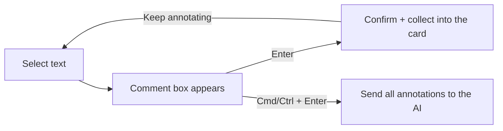

# Annotations — a DSH client plugin

[](https://www.npmjs.com/package/@fanfan4589/dsh-annotation)


Select text in a DeepSeek Harness reply, in a document previewed in the right sidebar, or in an HTML page preview; a comment box appears. `Enter` confirms the annotation and collects it into an aggregated "N notes" card above the composer; `Cmd/Ctrl+Enter` sends every pending annotation to the AI in one message.

[中文](README.zh.md)

> **Scope — a small, restrained patch.** It does one thing and leaves the rest of DSH alone: no built-in slot or layout replaced, no core behaviour touched, no other plugin's data read or written. Upgrading DSH normally needs no change here; disabling or uninstalling restores the stock UI.



## Usage

| Action | Result |
| --- | --- |
| Select text | The comment box appears next to the selection and gets focus |
| Type + `Enter` | Confirms the annotation; it is collected into the "N notes" card above the composer |
| `Cmd/Ctrl + Enter` | Confirms and immediately sends **all pending** annotations to the AI (works inside the comment box or while no input is focused) |
| `Shift + Enter` | Newline inside the comment |
| `Cmd/Ctrl + C` with no text selected in the comment box | Copies the passage that opened the box (focusing the box collapses the document selection) |
| `Esc` | Cancels the comment box |
| Click the "N notes" card | Expands the quotes and notes; jump to or delete each one |
| Click 探讨 / 修改 in the card | Chooses how the batch is sent: 探讨 (default) asks for answers; 修改 asks for edits. The choice is remembered |
| Send with text already in the composer | The typed message and all pending annotations go to the AI as one message (attachments preserved) |
| Click a numbered dot / highlighted text | Edit or delete that annotation; the number matches the aggregation card |

The message the AI receives looks like this:

```text
I annotated 2 specific places below:

1. Quote: "…"
   Location: conversation reply
   Note: …
2. Quote: "…"
   Location: `docs/report.md`
   Note: …

Answer each note; edit the referenced file only when a note explicitly asks for an edit.
```

The message language follows the current DSH UI language. On a successful send the batch leaves the page and storage at once: the message itself carries every quote and note, so no local backup is kept.

## Where it works, and the limits

| Surface | Supported |
| --- | --- |
| Assistant reply body in the conversation | Yes (including expanded reasoning) |
| Markdown / plain text / code previews in the right sidebar | Yes |
| PDF and Word/PowerPoint-to-PDF text layers in the right sidebar | Yes, where text is selectable |
| HTML page previews in the right sidebar | Yes (developer tools required) — the plugin registers an annotatable `.html`/`.htm` renderer that outranks the builtin one. The page still runs in an opaque-origin iframe; a bridge injected into the page reads the selection, paints highlights and draws numbered pins. The builtin HTML preview stays selectable in the preview's own implementation menu |
| Excel preview in the right sidebar | No — the grid is not document text |
| External web pages by URL | No — a genuinely cross-origin page has no injection point |
| Images, terminal | No |

Unsupported surfaces are limited by how the host renders them or by cross-origin rules, not by a plugin defect.

## Design choices

- **One highlight color.** The comments carry the emphasis, so there is no color picker.
- **Composer stays clean.** Annotations are not pasted into the input as text; they aggregate into one "N notes" card that expands on click.
- **No sidebar list.** No annotation manager panel and no sidebar entry: annotations exist where they were made (highlight and numbered dot) and in the aggregation card above the composer.
- **No export, copy, or diagnostics extras.** The plugin only annotates and sends.

## Annotation lifecycle

- Annotations live in `localStorage`, but only matter **before** sending: the sent message already contains every quote, location and note.
- **After sending** — the batch (chat and document) is removed from storage and the page immediately, highlights and numbered dots included; stale sent annotations are also pruned on startup.
- **Unsent annotations** — survive a reload through quote anchoring, so you can add notes, delete them or send later.
- **Deleted session** — its chat annotations are pruned automatically after startup. The automatic pass only runs once the session index is stable across two counts, so a partially loaded sidebar is never mistaken for deleted sessions.
- **Archived session** — its unsent annotations are kept because the session can be reopened.
- **Document annotations** — tied to the file path and never auto-pruned with a session; delete them from the dot beside the highlight.

## How it works

- **Client-only bundle.** `index.js` exports an empty `apply()`; all behavior lives in `client.js`.
- **Additive slots only** — no shipped UI is replaced:
  - `shell.overlay` — comment box, numbered dots, edit dialog, toasts;
  - `conversation.input.overlay` — the aggregated card above the composer;
  - `conversation.composer.dock` — the send bridge that folds annotations into a typed message.
- **Highlights use the CSS Custom Highlight API** (`::highlight()` + `CSS.highlights`), so React-owned text is never mutated and streaming/folding cannot conflict.
- **Quote anchoring** — each segment stores `exact/prefix/suffix/start`; re-renders resolve it with context scoring. Chat rows are addressed by `data-chat-anchor-key` inside `[data-conversation-session]`; sidebar documents by `data-textpreview-url` / resource address.
- **Sending** uses `sessions.scope(sessionId).conversation.send(text)` to deliver the batch as one user message.
- **Numbering** — only visible annotations are numbered: chat annotations of the active session plus annotations in the documents currently open, in creation order from 01. Other sessions, unopened documents and sent rows take no number, so a send resets the sequence to 01.
- **HTML previews** register the `@fanfan4589/dsh-annotation/html` document implementation (`priority: 'extension'`, above the builtin HTML renderer). A bridge script inside the frame owns selection extraction, quote re-anchoring, CSS Highlight painting, numbered pins, hit testing and jump; it talks to the parent runtime over `postMessage`. The parent stores only `exact/prefix/suffix/start` and never touches the frame document. Relative `<script src>` and `<link rel=stylesheet>` references are read under the file's own session authority and inlined as data URLs so a local report keeps its styling.
- **Sent cleanup** — a successful send removes the batch immediately; `cleanupSentAnnotations` prunes legacy leftovers on load.
- **Persistence** in `localStorage` under `dsh.annotation.v1` (per browser profile, synced across windows via `storage` events).

## Install

Install from npm:

```bash
dsh plugin --profile <profile> add @fanfan4589/dsh-annotation
```

Or ask the DSH agent to install the checkout with `plugin_manager` `install_bundle`, then refresh the page once.

Uninstall through Plugin Manager; annotations stay in `localStorage`.

## Development

```bash
node build.mjs                 # generate client.js
node --test test/core.test.mjs # 24 pure-logic tests
node test/smoke.mjs            # bundle load + slot registration + component render smoke test
node --test test/html.test.mjs # HTML address, asset inlining and bridge serialization
node tools/validate.mjs        # manifest/locale/icon/bundle validation
```

No dependencies beyond Node.js built-ins.

## Known limits

- Annotations live in the current browser profile only.
- HTML annotation depends on the host's developer tools (interactive HTML preview) setting; with it off the static, sanitized preview remains in force and HTML is not annotatable.
- Relative images, ES module scripts and runtime fetches are not packed into the HTML frame (same as the builtin interactive preview: the iframe has no same-origin access). A page with a strict Content-Security-Policy may block the injected bridge, leaving that page unannotatable.
- PDF support covers selectable text layers; scanned image-only PDFs cannot be annotated.
- Changes to `client.js` need a page refresh.
- If a third-party sidebar renders its own button over the selection, the comment box tries to avoid it.

## License

MIT © 2026 feifandiv
