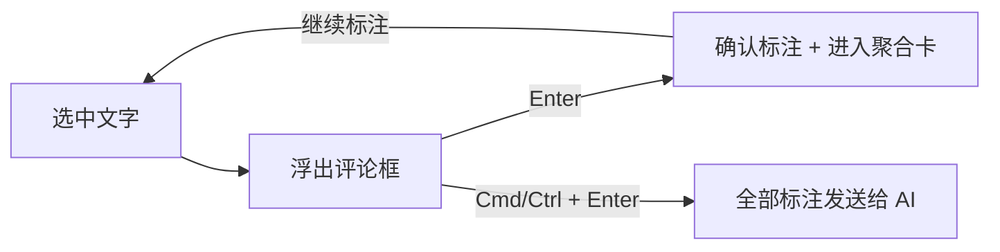

# 标注（Annotations）— DSH 客户端插件

给 DeepSeek Harness 加「划词标注」：在回复正文或右侧边栏文档里选中文字，浮出评论框；`Enter` 确认后评论进入输入框上方的聚合卡片，`Cmd/Ctrl+Enter` 把全部标注一次发给 AI。

[English](README.md)



## 使用

| 操作 | 结果 |
| --- | --- |
| 选中文字 | 选区旁浮出评论框并自动聚焦 |
| 输入 + `Enter` | 确认这条标注；评论收进输入框上方的「N 条注释」卡片 |
| `Cmd/Ctrl + Enter` | 确认并立即把**全部待发送标注**发给 AI（在评论框里、或页面不在输入框时都可用） |
| `Shift + Enter` | 评论内换行 |
| `Esc` | 取消评论框 |
| 点输入框上方的「N 条注释」卡片 | 展开查看每条标注的原文和评论，可点击跳转或删除 |
| 点文字旁的编号圆点 / 高亮文字 | 编辑这条标注的评论，或删除；编号与列表里的行号一致 |
| 左侧栏底部「标注」 | 在**右侧边栏**以原生 tab 打开标注列表（当前对话 / 文档 / 其他文档），可跳转或删除，不会挡住会话 |

发给 AI 的消息形如：

```text
我针对下面 2 处具体内容做了标注，请逐条查看并处理或修改：

1. 原文：「……」
   位置：对话回复正文
   批注：……
2. 原文：「……」
   位置：`docs/report.md`
   批注：……
```

消息语言跟随当前 DSH 界面语言。

## 能标注的位置与边界

| 位置 | 支持情况 |
| --- | --- |
| 对话中的助手回复正文 | 支持（含展开的思考过程） |
| 右侧边栏 Markdown / 纯文本 / 代码预览 | 支持 |
| 右侧边栏 PDF、Word/PowerPoint 转出的 PDF 文字层 | 支持（可选中文字的部分） |
| 右侧边栏 Excel 表格 | 不支持：表格选区不是文档文字 |
| 右侧边栏 HTML / 网页预览 | 不支持：正文运行在无同源权限的 iframe 里，父页面读不到其中的选区 |
| 图片、终端 | 不支持 |

这些限制来自宿主渲染方式，不是插件缺陷；不受支持的位置不会出现评论框。

## 设计取舍

- **只保留一种高亮色**：评论本身承载重点，不再让用户选颜色。
- **输入框里只放聚合卡**：标注不往输入框里塞大段文字，而是聚合成「N 条注释」卡片，点击可展开，保持输入区干净。
- **侧边栏列表保留**：需要回看全部标注时从左侧栏底部「标注」进入，列表作为右侧边栏的原生 tab 打开，和文档共用分栏。
- **没有导出/复制/诊断面板等附加功能**：插件只做标注和发送。

## 标注的生命周期

- 标注保存在 `localStorage`，列表只展示**当前会话的对话标注 + 文档标注**。
- **会话被删除**：该会话的对话标注会在启动后、或打开标注列表时自动清理。自动清理会等会话索引稳定（连续两次计数一致）才执行，避免启动时把未加载的会话误判为已删除。
- **会话被归档**：归档会话仍可重新打开，所以标注保留；它不计入当前会话角标。需要清理时用列表右上角「清理 → 清理其他会话」。
- **已发送的标注**：高亮和列表记录都会保留，直到你点「清理 → 清理已发送」。
- **文档标注**：绑定文件路径，不随会话删除自动清理；逐条删除即可。

## 实现要点

- **纯客户端插件**：`index.js` 只导出空 `apply()` 满足 bundle 行，能力全部在 `client.js`。
- **只做新增槽位**，不改动任何内置 UI：
  - `shell.overlay`：浮出评论框、圆点、编辑弹窗、标注列表、提示条；
  - `conversation.input.overlay`：输入框上方的聚合卡片；
  - `sidebar.right.pane.tab`：右侧边栏的标注列表 tab（通过 `sidebarRightTabs` 注册 `annotation` 类型）；
  - `sidebar.footer.action`：左侧栏底部「标注」入口，点击打开/聚焦上面的 tab。
- 高亮用 **CSS Custom Highlight API**（`::highlight()` + `CSS.highlights`），不修改 React 管理的 DOM，流式渲染、折叠都不会丢标注。
- **引用锚定**：每段保存 `exact/prefix/suffix/start`，重渲染后按上下文评分重新匹配。对话按 `[data-conversation-session]` + `data-chat-anchor-key` 定位；文档按 `data-textpreview-url` / 资源地址定位。
- **发送**走 `sessions.scope(sessionId).conversation.send(text)`，把待发送标注合成一条用户消息。
- **编号**：按创建时间给「当前会话的对话标注 + 文档标注」统一编号 1..N，圆点、聚合卡和侧边栏列表使用同一套编号。
- **持久化**：`localStorage` 键 `dsh.annotation.v1`（按浏览器 profile 保存，多窗口经 `storage` 事件同步）。

## 安装

本目录即插件 bundle。对 DSH Agent 说「把 /absolute/path/to/annotation 这个插件装上」，或用 `plugin_manager` 的 `install_bundle` 指向该绝对路径；装好后刷新一次页面。

卸载：在 Plugin Manager 移除/禁用该 bundle；标注数据保留在 `localStorage`。

## 开发与校验

```bash
node build.mjs                 # 生成 client.js
node --test test/core.test.mjs # 20 个纯逻辑用例
node test/smoke.mjs            # 产物加载 + 槽位注册 + 组件渲染冒烟
node tools/validate.mjs        # manifest/locale/icon/产物校验
```

只依赖 Node.js 内置模块，无需安装依赖。

```
src/core.js      纯逻辑：引用锚定、持久化、待发送/发送消息
src/engine.js    DOM：选区捕获、重锚定、CSS Highlight、交互监听
src/ui.js        React：评论框、编辑弹窗、圆点、聚合卡、列表
src/strings.js   运行时 zh/en 词典
src/plugin.js    客户端插件主体与槽位注册
build.mjs        拼接 src/*.js 为浏览器产物 client.js
```

## 已知限制

- 标注只存在当前浏览器 profile，不做跨设备同步。
- PDF 仅支持可选中的文字层（纯图片 PDF 无法标注）。
- 修改 `client.js` 后需要刷新页面。
- 第三方侧边栏若在选区上方渲染自己的按钮，评论框会尽量避让。

## License

MIT © 2026 feifandiv
