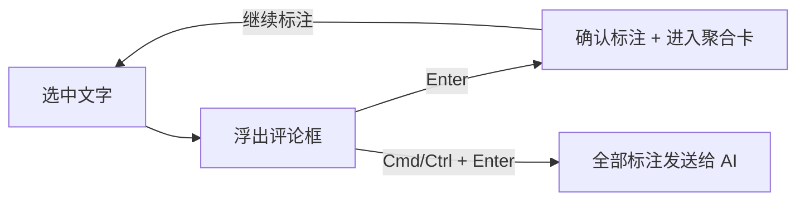

# 标注（Annotations）— DSH 客户端插件

[](https://www.npmjs.com/package/@fanfan4589/dsh-annotation)


给 DeepSeek Harness 加「划词标注」：在回复正文、右侧边栏文档或 HTML 网页预览里选中文字，浮出评论框；`Enter` 确认后评论进入输入框上方的聚合卡片，`Cmd/Ctrl+Enter` 把全部标注一次发给 AI。

[English](README.md)

> **定位｜克制的小功能补丁。** 只做这一件事，不改 DSH 主体：不替换内置槽位与布局、不改内核行为、不碰其他插件的数据。升级 DSH 一般无需跟着改；关掉或卸载即回到官方状态。



## 使用

| 操作 | 结果 |
| --- | --- |
| 选中文字 | 选区旁浮出评论框并自动聚焦 |
| 输入 + `Enter` | 确认这条标注；评论收进输入框上方的「N 条注释」卡片 |
| `Cmd/Ctrl + Enter` | 确认并立即把**全部待发送标注**发给 AI（在评论框里、或页面不在输入框时都可用） |
| `Shift + Enter` | 评论内换行 |
| 评论框内没选中文字时按 `Cmd/Ctrl + C` | 复制最初选中的原文（评论框聚焦会折叠文档选区） |
| `Esc` | 取消评论框 |
| 点输入框上方的「N 条注释」卡片 | 展开查看每条标注的原文和评论，可点击跳转或删除 |
| 输入框已有文字时点发送 | 输入框文字 + 全部待发送标注合并成一条消息发给 AI（附件保留） |
| 点文字旁的编号圆点 / 高亮文字 | 编辑这条标注的评论，或删除；编号与聚合卡里的编号一致 |

发给 AI 的消息形如：

```text
我针对下面 2 处具体内容做了标注，请逐条查看并处理或修改：

1. 原文：「……」
   位置：对话回复正文
   批注：……
2. 原文：「……」
   位置：`docs/report.md`
   批注：……
```

消息语言跟随当前 DSH 界面语言。发送成功后本轮标注会立即从页面和存储里移除——发给 AI 的那条消息本身就带着每处原文和批注，不需要再在本地留一份备份。

## 能标注的位置与边界

| 位置 | 支持情况 |
| --- | --- |
| 对话中的助手回复正文 | 支持（含展开的思考过程） |
| 右侧边栏 Markdown / 纯文本 / 代码预览 | 支持 |
| 右侧边栏 PDF、Word/PowerPoint 转出的 PDF 文字层 | 支持（可选中文字的部分） |
| 右侧边栏 HTML 网页预览 | 支持（需开启开发者工具）：插件注册一个可标注的 HTML 渲染器接管 `.html`/`.htm`，页面仍跑在无同源权限的 iframe 里，由注入页内的桥接脚本读选区、画高亮、放编号圆点；内置 HTML 预览可在预览工具栏的实现菜单里切回 |
| 右侧边栏 Excel 表格 | 不支持：表格选区不是文档文字 |
| 外部网页 URL | 不支持：真正的跨域页面没有注入点 |
| 图片、终端 | 不支持 |

未支持的位置来自宿主渲染方式或跨域限制，不是插件缺陷；不受支持的位置不会出现评论框。

## 设计取舍

- **只保留一种高亮色**：评论本身承载重点，不再让用户选颜色。
- **输入框里只放聚合卡**：标注不往输入框里塞大段文字，而是聚合成「N 条注释」卡片，点击可展开，保持输入区干净。
- **不做侧边栏列表**：不做标注管理面板，也不在侧边栏放入口。标注只在它出现的位置（高亮 + 编号圆点）和输入框上方的聚合卡里存在，避免多一套需要维护的列表和清理入口。
- **没有导出/复制/诊断面板等附加功能**：插件只做标注和发送。

## 标注的生命周期

- 标注保存在 `localStorage`，但只在**发送前**有意义：发出去的那条消息里已经包含原文、位置和批注。
- **发送后**：本轮标注（对话 + 文档）立即从存储和页面上移除，高亮与编号圆点一起消失；启动时也会清理以前遗留的已发送标注。
- **未发送的标注**：刷新页面后仍会按引用锚定重新出现，可以继续补批注、删除或发送。
- **会话被删除**：该会话的对话标注会在启动后自动清理。自动清理会等会话索引稳定（连续两次计数一致）才执行，避免启动时把未加载的会话误判为已删除。
- **会话被归档**：归档会话仍可重新打开，所以它的未发送标注保留。
- **文档标注**：绑定文件路径，不随会话删除自动清理；可以在高亮旁的圆点里逐条删除。

## 实现要点

- **纯客户端插件**：`index.js` 只导出空 `apply()` 满足 bundle 行，能力全部在 `client.js`。
- **只做新增槽位**，不改动任何内置 UI：
  - `shell.overlay`：浮出评论框、编号圆点、编辑弹窗、提示条；
  - `conversation.input.overlay`：输入框上方的聚合卡片；
  - `conversation.composer.dock`：发送桥（输入框有文字时把标注并入同一条消息）。
- 高亮用 **CSS Custom Highlight API**（`::highlight()` + `CSS.highlights`），不修改 React 管理的 DOM，流式渲染、折叠都不会丢标注。
- **引用锚定**：每段保存 `exact/prefix/suffix/start`，重渲染后按上下文评分重新匹配。对话按 `[data-conversation-session]` + `data-chat-anchor-key` 定位；文档按 `data-textpreview-url` / 资源地址定位。
- **发送**走 `sessions.scope(sessionId).conversation.send(text)`，把待发送标注合成一条用户消息。
- **编号**：只给当前可见的标注编号——当前会话的对话标注 + 当前打开文档里的标注，按创建时间从 01 开始连续编号；其他会话、未打开文档、已发送的标注不占号，所以每次发送后序号自然回到 01。
- **HTML 预览**：注册 `@fanfan4589/dsh-annotation/html` 这个文档实现（`priority: 'extension'`，高于内置 HTML 渲染器），在 iframe 内注入桥接脚本：选区与引用锚定、CSS Highlight 绘制、编号圆点、命中测试、跳转都在帧内完成，通过 `postMessage` 与父页面的运行时通信。父页面只存 `exact/prefix/suffix/start`，不碰 iframe 的 DOM。相对路径的 `<script src>` / `<link rel=stylesheet>` 会在文件自身会话权限下读取并以内联 data URL 注入，保持本地报告页的样式。
- **发送后清理**：发送成功后立即移除本轮全部标注；`cleanupSentAnnotations` 在启动时清掉遗留的已发送记录。
- **持久化**：`localStorage` 键 `dsh.annotation.v1`（按浏览器 profile 保存，多窗口经 `storage` 事件同步）。

## 安装

从 npm 安装：

```bash
dsh plugin --profile <profile> add @fanfan4589/dsh-annotation
```

或对 DSH Agent 说「把 `/absolute/path/to/dsh-annotation` 这个插件装上」，用 `plugin_manager` 的 `install_bundle` 指向该目录。装好后刷新一次页面。

卸载：在 Plugin Manager 移除/禁用该 bundle；标注数据保留在 `localStorage`。

## 开发与校验

```bash
node build.mjs                 # 生成 client.js
node --test test/core.test.mjs # 21 个纯逻辑用例
node test/smoke.mjs            # 产物加载 + 槽位注册 + 组件渲染冒烟
node --test test/html.test.mjs # HTML 地址、资产内联与桥接序列化
node tools/validate.mjs        # manifest/locale/icon/产物校验
```

只依赖 Node.js 内置模块，无需安装依赖。

```
src/core.js      纯逻辑：引用锚定、持久化、待发送/发送消息
src/html.js      可标注 HTML 渲染器 + iframe 内的桥接脚本
src/engine.js    DOM：选区捕获、重锚定、CSS Highlight、交互监听
src/ui.js        React：评论框、编辑弹窗、圆点、聚合卡、发送桥
src/strings.js   运行时 zh/en 词典
src/plugin.js    客户端插件主体与槽位注册
build.mjs        拼接 src/*.js 为浏览器产物 client.js
```

## 已知限制

- 标注只存在当前浏览器 profile，不做跨设备同步。
- HTML 标注依赖宿主的「开发者工具 / 交互式 HTML 预览」开关；关闭时只用内置的静态安全预览，HTML 不可标注。
- HTML 预览里相对路径的图片、ES module 脚本、运行时 fetch 不会被内联（与内置交互预览一致，iframe 无同源权限）。页面自带严格 CSP 时，注入的桥接脚本可能被拦下，该页不可标注。
- PDF 仅支持可选中的文字层（纯图片 PDF 无法标注）。
- 修改 `client.js` 后需要刷新页面。
- 第三方侧边栏若在选区上方渲染自己的按钮，评论框会尽量避让。

## License

MIT © 2026 feifandiv
